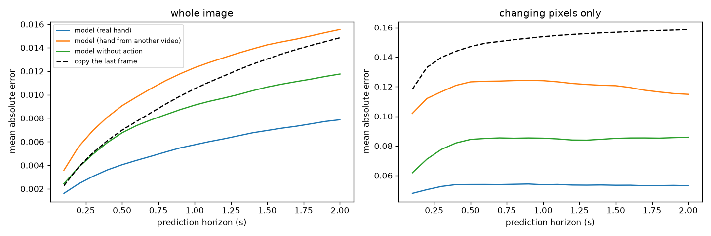
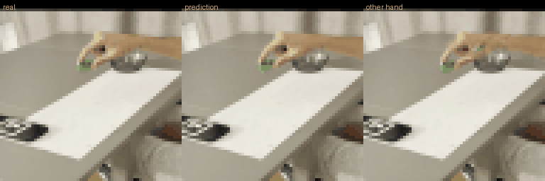

# Action-conditioned video prediction from phone videos of my own hand

Application to the Humanoid Robot Learning Research internship challenge.

All data comes from a phone: 40 videos I recorded of my right hand picking up a small object from 8 marked
positions and dropping it into a bowl. I trained a small world model that predicts the next frame from the
current frame and the state of the hand, and tested it on start positions it never saw during training.

I used Claude (Anthropic) as a coding assistant. The numbers below are copied from the output of the scripts
and notebook in this repo.

## Summary
- Data: 40 videos (38 usable), fixed phone camera, 8 start positions x 5 repetitions.
- On two start positions never seen in training, the model beats "copy the last frame" at every horizon up to
  2 s. Its error roughly doubles when it is given the hand of another video, so it does use the hand.
- Position of the object (a green box about 7 px wide): median error 0.4 to 0.7 px with the real hand, against
  4.8 to 10.8 px for copying the last frame.
- Did not work: replaying my hand trajectories in the LIBERO simulator. No policy was trained.

## Data
- 40 videos (4K, 30 fps), 8 start positions x 5 repetitions, one object, one bowl, one hand.
- 38 are usable: `pickplace_pos02_rep2` (no pinch gesture detected) and `pickplace_pos08_rep1` (gripper not open
  before the grasp) were rejected by the gesture detector.
- The camera moved between recordings (the marker shifted by about 80 to 115 px relative to the calibration
  video), so every video is registered to a reference view with an ArUco marker.
- The first three videos (`pos01_rep1`, `pos01_rep2`, `pos02_rep1`) were recorded under different lighting: the
  marker was detected in 63 to 78 % of their frames (about 100 % in the others). I kept them.
- Raw videos are not in the repo (size). `data/processed/wm_data.npz` contains the frames and hand states used
  for training.

## Hand tracking
- Calibration: 8 crosses drawn 10 cm apart on a sheet of paper, clicked on one frame. The grid is consistent
  to 0.09 cm on average, the reprojection error is 5.6 px (approximate focal length), and the computed camera
  height is 37.5 cm against 38 cm measured with a ruler.
- Tracking: MediaPipe Hand Landmarker on every frame. The pinch point is the midpoint of the thumb tip and the
  index tip. The opening is the thumb-index distance in MediaPipe's metric hand model.
- Measured accuracy, after registration:
  - Pinch position on the table, tested by touching the 8 crosses: 2.0 cm mean error (1.6 to 2.8 cm). Without
    registration it was 7.5 cm. One video, 8 contacts, matched to the crosses in time order.
  - Grasp point against the cross the object was placed on: 1.3 cm mean, 1.1 cm median, 3.0 cm max, over 38
    videos. This depends on an assumed grasp height of 1.0 cm.
- Not measured: the height of the hand. Monocular depth (MediaPipe + PnP) put the hand about 31 % too close to
  the camera in the contact test, so I do not use it. The release height of 13.8 cm (std 2.0 cm across videos)
  is inferred by assuming the hand is above the centre of the bowl; the bowl centre comes from two ruler
  measurements.
- The world model uses only the pinch position in the image (registered to the reference view) and the
  opening. The table-frame trajectories and assumed heights (`src/03_trajectory.py`) were built for the LIBERO
  attempt and are not inputs to the world model.

## World model
- Data: the crop `[264, 59, 2160, 2608]` of the 4K reference view, resized to 64x64 (stretched), one frame out
  of three (10 fps). 5796 frames.
- Hand state per frame: pinch x and y (normalised to the crop), opening divided by 15 cm, and a hand-present flag.
- Model: a small U-Net (3 resolution levels, 32/64/128 channels, GroupNorm, GELU). Input: the RGB frame plus
  4 maps: a Gaussian blob at the pinch position at t and at t+1 (sigma 2.5 px), and constant maps for the
  opening at t and t+1. Output: frame t+1 as frame t plus a predicted change. The last layer starts at zero, so
  the model starts as "copy the last frame".
- Training: L1 loss with the pixels that change (mean absolute difference above 0.04) weighted 6x; 4-step
  rollouts that feed the model its own predictions; 4000 steps, batch 64, AdamW (learning rate 1e-3, one-cycle,
  weight decay 1e-4), gradient clipping at 1.0; light brightness augmentation; the checkpoint with the best
  validation error is kept. About 24 minutes per model on a Colab GPU. Two models were trained on the same data
  with the same seed: one with the hand, one with the hand maps set to zero.
- Split by start position, fixed before training: positions 03 and 06 are never seen in training (10 test
  videos); repetition 5 of the other positions is validation (6 videos); 22 videos are used for training.
- Evaluation: from the first frame of 20-step windows (2 s), taken every 5 frames in each test video, the model
  predicts the following frames using the true hand states of the window. Metrics: mean absolute error per
  horizon on the whole image, and on "changing pixels" (the mask comes from the real future frame and is used
  for measurement only). Baselines: copy the last frame; the same model with the hand of another test video;
  the same model without the hand.
- Object metric: I locate the green box (centroid of the pixels where green exceeds red and blue by 0.07, green
  above 0.20, at least 3 pixels) in real and predicted frames, over windows where the real box moves by more than
  3 px. I report the median position error where the box is found in the prediction. The thresholds were adjusted
  after looking at frames from one training video and one test video. This metric is computed in the Colab session only (see Reproduce). The box is sometimes not detected once it is inside the bowl (seen through the glass), which removes
  those windows.

## Results

Validation (start positions seen in training, repetition 5, 0.4 s, whole image, all windows of the 6 validation videos (every third frame as a start, 292 windows)):
copy last frame 0.0043, model without hand 0.0032, model with hand 0.0024.

Test (start positions 03 and 06, never seen in training, 10 videos, one training run per model). Mean absolute
error between predicted and real frames.

Pixels that really change:

| Horizon | Copy last frame | Model, real hand | Model, hand of another video | Model, no hand |
|---|---|---|---|---|
| 0.5 s | 0.1471 | 0.0539 | 0.1233 | 0.0843 |
| 1.0 s | 0.1537 | 0.0538 | 0.1241 | 0.0852 |
| 2.0 s | 0.1585 | 0.0531 | 0.1149 | 0.0858 |

Whole image:

| Horizon | Copy last frame | Model, real hand | Model, hand of another video | Model, no hand |
|---|---|---|---|---|
| 0.5 s | 0.0070 | 0.0040 | 0.0091 | 0.0068 |
| 1.0 s | 0.0105 | 0.0057 | 0.0123 | 0.0091 |
| 2.0 s | 0.0148 | 0.0079 | 0.0155 | 0.0118 |

With the real hand, the error is about 63 to 67 % lower than copying the last frame on changing pixels, and 43 to
47 % lower on the whole image. With the hand of another video the error on changing pixels is about 2.2 times
higher, and on the whole image it is worse than copying the last frame, so the model does use the hand. Without
the hand it lies in between: it learns part of the typical dynamics of the scene. The model stays better than
copying the last frame over the whole 2 s evaluated. The curve is flat partly because the true hand state is
given at every step.



Position of the green box (test positions 03 and 06). Median error in pixels of the 64x64 image, the box is
about 7 px wide:

| Horizon | Windows | Copy last frame | Model, real hand | Model, hand of another video | Model, no hand |
|---|---|---|---|---|---|
| 0.5 s | 58 | 4.8 | 0.4 | 5.0 | 2.2 |
| 1.0 s | 93 | 7.4 | 0.5 | 6.3 | 3.9 |
| 2.0 s | 119 | 10.8 | 0.7 | 7.6 | 6.2 |

The box is found in 92 to 94 % of the predictions with the real hand, 100 % with the hand of another video and
82 to 97 % without the hand.

Qualitative rollout. The window was chosen because the box moves the most (grasp and carry), so it is not an
average case. Rows: real, prediction, prediction with the hand of another video. Columns: 0.5, 1, 1.5 and 2 s.
The prediction follows the real hand and box, with faint speckle artifacts around the hand and the bowl after
about 1 s. With the hand of another video, ghost hands and several green blobs appear.



## What did not work
- Replaying my trajectories in the LIBERO simulator (task: alphabet soup into the basket, run on Colab). A
  scripted controller succeeds at 7 of 8 grid positions after shifting the grid 4 cm towards the robot. Without
  the shift, 3 positions failed: the arm stalls with the elbow almost straight. I did not establish the cause.
  Replaying the human trajectory failed on both positions tested: on one the object was grasped but dropped
  about 6 cm from the basket, on the other the gripper closed about 8 cm away from the object. I stopped there
  and did not train a policy.
- Hand height from monocular depth (see Hand tracking).

## Limitations
- 38 videos, one scene, one hand, one object. The test set is 2 start positions (10 videos) and the windows
  overlap. One training run per model, no confidence intervals: small gaps (for example 0.0068 against 0.0070)
  mean nothing.
- 64x64 images from a stretched crop; the object is about 7 px wide.
- The model is given the true hand state, including where the hand goes next, so this is action-conditioned
  prediction, not planning. A large part of the changing pixels is the hand itself, which the model is told where
  to place. While the box is held it sits at the pinch point, which the model also receives, so a low box error
  there is expected. I did not test a "box = pinch point" baseline.
- The "action" is the hand position in the image, not robot commands.
- The opening is in MediaPipe's hand-model units: in the calibration video its maximum was 13.1 cm, against about
  15 cm measured with a ruler.
- The set of changing pixels depends on the horizon, so compare models at a given horizon, not horizons with
  each other. "Better than copying the last frame over 2 s" is a statement about that baseline only.

## Repository layout
- `src/00_check_videos.py` ... `src/05_prepare_wm.py`: video check, calibration, hand tracking, trajectories,
  release height, world-model data. `src/06_evaluate_wm.py`: evaluation on CPU. `src/diagnostics/`: checks I
  used along the way.
- `src/07_train_wm.py`: trains the two models (writes to `checkpoints_retrain/`).
- `notebooks/colab_session.ipynb`: the raw Colab session I used (see Reproduce).
- `checkpoints/`: `wm_act.pt` (with hand), `wm_noact.pt` (without hand).
- `data/processed/`: `calib.npz`, `traj_*.npz`, `wm_data.npz`.
- `results/`: figures.

## Reproduce
The data pipeline needs the raw videos, which are not in this repo. The training and the evaluation do not.

Evaluation (CPU, no raw videos): `pip install -r requirements.txt torch`, then `python src/06_evaluate_wm.py`.
It loads `data/processed/wm_data.npz` and the checkpoints, and writes the curves and the rollout in `results/`.

Training (GPU recommended, about 24 minutes per model on a Colab T4): `python src/07_train_wm.py`. It writes to
`checkpoints_retrain/`, not over the committed checkpoints, and results will not be bit-identical (hardware, random
streams). Quick check on CPU: `python src/07_train_wm.py --steps 20 --bs 8 --models act --out /tmp/wm_smoke`.

The object metric (green box) was computed in the Colab session saved as `notebooks/colab_session.ipynb`. That
notebook is raw: two of its cells (data loading and evaluation) were cut short when I saved it, so it cannot be
re-run top to bottom. The object-metric code is in it, but this one number is not reproducible from the repo as it
stands.

Data pipeline (needs the raw videos in `data/raw/`):
```
python3 -m venv .venv && source .venv/bin/activate
pip install -r requirements.txt
mkdir -p models
curl -L -o models/hand_landmarker.task https://storage.googleapis.com/mediapipe-models/hand_landmarker/hand_landmarker/float16/1/hand_landmarker.task
python src/01_calibrate.py        # click the 8 crosses
python src/02_extract_hand.py
python src/03_trajectory.py
python src/04_release_height.py
python src/05_prepare_wm.py
```